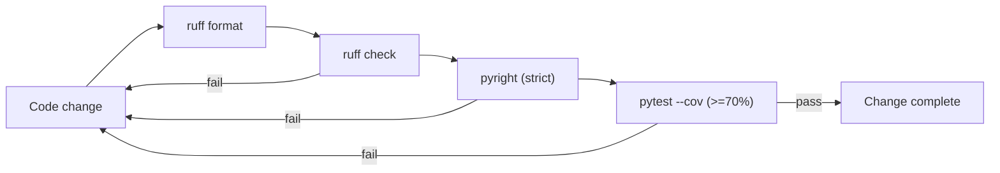

# ADR 0001: Code Maintainability and Quality Gates

- Status: Accepted
- Date: 2026-10-26
- Deciders: Project maintainer

This ADR establishes the non-negotiable quality gates for the project: automated tests, a minimum test-coverage floor, and enforced linting, formatting, and type checking. It exists so that code moving out of exploratory notebooks and into the installable `toy_bald` package cannot silently regress.

## Context

The project is transitioning from prototype notebooks into a structured Python package (`src/toy_bald`) with entry scripts for training and dataset synthesis. Notebooks are excellent for exploration but offer no regression safety net, no type guarantees, and no consistent style. As logic migrates into the package, it must be held to a standard that keeps it correct, readable, and safe to refactor.

The toolchain is already partially declared in [environment.yaml](../../environment.yaml) (pytest, hypothesis, ruff, pyright) and [pyproject.toml](../../pyproject.toml) (ruff, pyright, and pytest configuration). This ADR formalizes how those tools are used and adds a coverage requirement that is not yet wired in.

## Decision

We adopt four mandatory gates. All four must pass locally before any change is considered complete, and they are the reference for any future CI pipeline.

### 1. Automated unit tests (pytest)

Every behavioral change ships with tests. Tests live under [tests/](../../tests) and mirror the package layout, and they are discovered via the existing `testpaths = ["tests"]` and `pythonpath = ["src"]` settings.

- Test names state the scenario and expected outcome, e.g. `test_augmentation_is_deterministic_and_resolves_placeholders`.
- Each test carries a Behavior-Driven-Development docstring structured as Given / When / Then.
- Heavy or external components (LLM endpoints, network, GPU) are never hit directly. They are isolated behind injectable seams such as the `ChatCompletionsAdapter` abstraction, with deterministic mock/sequenced implementations for tests.
- Every test is independent and reproducible: no shared mutable global state, seeded RNGs, and no reliance on wall-clock time.
- The `gpu` and `slow` markers gate expensive tests; the default `addopts = "-m 'not gpu and not slow'"` keeps the everyday suite fast.

### 2. Minimum 70% test coverage

Line coverage must be at least 70% for the `toy_bald` package. This is enforced with `pytest-cov`, which must be added to the environment.

Run and enforce with:

```bash
pytest --cov=toy_bald --cov-report=term-missing --cov-fail-under=70
```

The 70% floor is a pragmatic minimum, not a target. Core business transformations (temporal window alignment, phrase rendering, augmentation, serialization) are expected to sit well above it; trivial pass-through wrappers are not padded with low-value tests to inflate the number.

### 3. Linting and formatting (Ruff)

Ruff is the single tool for both linting and formatting, configured in [pyproject.toml](../../pyproject.toml). Its rule set is `E, F, I, UP, B, SIM, RUF` at `line-length = 100`, targeting `py313`.

```bash
ruff check .          # lint
ruff format .         # format
ruff check --fix .    # apply safe autofixes
```

### 4. Strict static type checking (Pyright)

Pyright runs in `strict` mode over `src`, `training`, `evaluation`, and `tests`. Explicit type hints are required; catch-all types (`Any`) are avoided unless a boundary genuinely demands them.

```bash
pyright
```

## Tooling summary

The table below is the canonical mapping of concern to tool and command.

| Concern | Tool | Command                                     | Enforced by |
| --- | --- |---------------------------------------------| --- |
| Unit testing | pytest | `pytest`                                    | `[tool.pytest.ini_options]` |
| Coverage floor (>=70%) | pytest-cov | `pytest --cov=toy_bald --cov-fail-under=70` | this ADR (to be wired) |
| Property tests | hypothesis | used within pytest                          | test authorship |
| Lint | ruff | `ruff check .`                              | `[tool.ruff.lint]` |
| Format | ruff | `ruff format .`                             | `[tool.ruff]` |
| Types | pyright | `pyright`                                   | `[tool.pyright]` |

## Local verification loop

The required order of operations before finalizing a change is format, lint, type-check, then test with coverage. Any failure is analyzed and fixed before re-running until the loop passes cleanly.



*The loop is iterative: any red gate sends the change back for correction.*

## Consequences

The upside is a codebase that stays refactor-safe, self-documenting, and consistent, with regressions caught before they land. The cost is real but accepted.

- Positive: regressions are caught early; the package is safe to refactor; style and typing are uniform; onboarding is easier because tests document intent.
- Negative: every change carries test and typing overhead; strict Pyright can be noisy around third-party libraries lacking stubs (mitigated by `reportMissingTypeStubs = false`).
- Follow-up: add `pytest-cov` to [environment.yaml](../../environment.yaml); optionally encode `--cov-fail-under=70` into `addopts`; wire these gates into CI when a pipeline is introduced.
